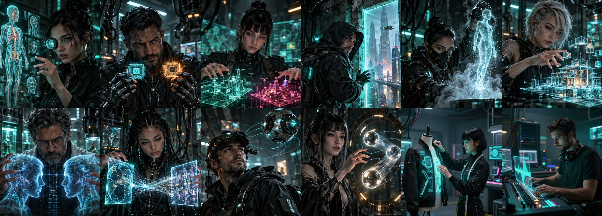

# ◈ Neural Underground

**12 ComfyUI workflows in a single cyberpunk-style panel.** Image, editing, video, interpolation and music: pick a module,
fill in four clear controls and run it, without touching a node. And when you want to tinker, the full workflow is right
underneath.

*Versión en español: [README.md](README.md). The panel itself is in Spanish.*



## The modules

| # | Module | What it does | Engine |
|---|---|---|---|
| 01 | **El Escáner** (The Scanner) | Describes an image (to reuse as a prompt) and extracts the pose skeleton | Qwen3-VL 8B · DWPose |
| 02 | **El Implante** (The Implant) | Text → image blending up to two style LoRAs | Z-Image Turbo |
| 03 | **Los Sectores** (The Sectors) | Composes the image by halves: what goes left and what goes right | Qwen-Image-2512 |
| 04 | **La Fuga** (The Escape) | Extends the image beyond its borders (outpainting) without touching the original | Qwen-Image-Edit-2511 |
| 05 | **El Aislante** (The Isolator) | Removes the background and saves a transparent PNG | BiRefNet |
| 06 | **La Mutación** (The Mutation) | Edits an image with instructions: "make it night", "give him a red coat" | Qwen-Image-Edit-2511 |
| 07 | **El Doble** (The Double) | Four variants with the same seed and different samplers, to compare them | Z-Image Turbo |
| 08 | **El Puente** (The Bridge) | Video between two images (first and last frame) | Wan 2.2 |
| 09 | **La Órbita** (The Orbit) | Image → video directing the camera: zoom, orbit, pan | Wan 2.2 Fun Camera |
| 10 | **El Cronista** (The Chronicler) | Adds frames to raise FPS or make slow motion | FILM |
| 11 | **El Sastre** (The Tailor) | Merges two images: a person with the clothes, object or background of another | Qwen-Image-Edit-2511 |
| 12 | **El Compositor** (The Composer) | Full songs with vocals from a style and lyrics | ACE-Step 1.5 |

Results move between modules with **"Enviar a…"** ("send to"): describe a photo with the Scanner and send it as a prompt to
the Implant, edit it with the Mutation and animate it with the Orbit… without downloading or re-uploading anything.

## Requirements

- **ComfyUI 0.37 or newer.**
- **16 GB VRAM GPU** and **32 GB RAM**. Tested on an RTX 5070 Ti.
- **Disk:** about 180 GB for all 12 modules. You can install only the ones you want.

## Installation

1. **Clone Neural** into `ComfyUI/custom_nodes`:
   ```bash
   cd ComfyUI/custom_nodes
   git clone https://github.com/Gustaafvito/neural-underground neural_underground
   ```
2. **Nodes:** almost everything is native ComfyUI. Only the Scanner (01) needs
   [comfyui_controlnet_aux](https://github.com/Fannovel16/comfyui_controlnet_aux) (install it with *ComfyUI-Manager →
   Install Missing Custom Nodes*).
3. **Download the models** for the modules you want: folders, sizes and links in **[MODELS.md](MODELS.md)**.
4. **Restart ComfyUI** and reload the browser (Ctrl+F5).

## How to use it

- Press the **◈ NEURAL** button to open **El Nexo** (the hub), the screen with the 12 modules.
- Pick a module, upload your image or video and adjust its controls (prompts work best in English).
- Run it. Results show up in the panel with their **"Enviar a…"** button.
- **⌬ Ver nodos** shows the ComfyUI workflow underneath; to come back, press **◈ Volver a …** (bottom centre).
- **🎲 Sorpréndeme** fills the module with a ready-made idea, so you can try it without writing a prompt.
- **Mejorar con IA** ("improve with AI", in the Sectors, Implant, Double, Bridge and Orbit): Qwen3-VL 8B rewrites your text
  into a detailed prompt; in the video modules it also looks at your start image. It is optional: when off the model is not
  loaded, and the prompt used is shown in the results. `qwen3vl_8b_int8_convrot` is only needed for this and for the Scanner.

## Music and voices

Each specialist has its own **cover song**, an **ambient loop** while you work and a **welcome voice** when you enter its
module; El Nexo plays the theme **"Señal Subterránea"**. The music ducks automatically while a specialist speaks.
The **🔊 Música** and **🗣 Voz** buttons in the header turn them off, and **🗣 Escuchar presentación** replays the voice.

**Your own LoRAs in the Implant:** put your Z-Image LoRAs in `ComfyUI/models/loras` (any subfolder works) and reload.
The panel only lists Z-Image LoRAs, and if a LoRA carries its trigger word, it adds it to the description when you pick it.
The default LoRAs belong to the author: if you don't have them, the panel asks you to pick one of yours.

The workflows also show up in ComfyUI's template browser, under *neural_underground*.

## Licenses

- **Code, workflows and panel images:** [GPL-3.0](LICENSE), same as ComfyUI.
- **Models:** each has its own license; every model Neural uses allows free use (Apache 2.0 / MIT). You download them
  yourself from their official pages. Details in [LICENCIAS.md](LICENCIAS.md) (Spanish).
- The module covers are **AI-generated**.
- **Music:** generated by the author with ACE-Step 1.5 XL. **Voices:** created by the author with ElevenLabs (plan with a commercial license).
  They are included in the pack under the project's license.

## Credits

- Models: Alibaba Qwen (Qwen3-VL, Qwen-Image), Tongyi-MAI (Z-Image), Wan-AI (Wan 2.2), lightx2v (Lightning), ZhengPeng7
  (BiRefNet), Google Research (FILM), ACE-Step, and RunningHub (DetailDaemonZ LoRA).
- Nodes: Fannovel16 (controlnet_aux) and the ComfyUI team.

Made by **gustaafvito.creador.ia** · also by him: [La Casa Maldita](https://github.com/Gustaafvito/la-casa-maldita).
